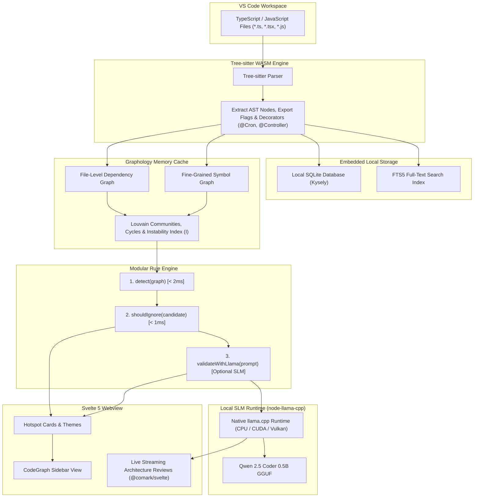

# CodeGraph RAG & Architecture Intelligence

> **Deterministic Code Property Graphs meet Local Small Language Models (SLMs) for zero-latency, privacy-preserving architectural intelligence in VS Code.**

CodeGraph RAG is an architectural analysis engine and pair-programming assistant for TypeScript and JavaScript codebases. It combines **Tree-sitter AST parsing**, in-memory **Graphology dependency graphs**, embedded **SQLite FTS5 lexical search**, and **local GGUF Small Language Models** (Qwen 2.5 Coder 0.5B via `node-llama-cpp`) to detect architectural drift, structural code smells, cyclic dependencies, and leaky abstractions directly inside VS Code — **100% locally with zero cloud API dependencies**.

---

## 🎯 What Is It For?

Modern software architectures degrade over time as deadlines loom: files balloon into thousand-line monoliths, presentation components bypass domain logic to query databases directly, and circular import cycles sneak into production builds.

Traditional linters only inspect individual files within abstract syntax trees, completely blind to workspace-wide coupling. Meanwhile, commercial AI tools require uploading entire codebases to external cloud providers, which is often slow, expensive, and unacceptable for private or proprietary IP.

**CodeGraph RAG solves this with a hybrid approach:**
1. **Mathematical Graph Rigor:** Analyzes graph topology across the entire workspace in RAM (< 2ms) using graph theory (Tarjan's cycle detection, Louvain modularity communities, and Martin instability metrics).
2. **Deterministic Noise Filtering:** Eliminates ~80% of false positives in < 1ms by whitelisting type-only imports, DTO mappers, vertical slice directories, and framework wiring.
3. **Local SLM Sanity Check & Deep Audits:** Leverages a lightweight, local GGUF model (Qwen 2.5 Coder 0.5B) running on native CPU/GPU hardware to evaluate ambiguous patterns and stream concrete refactoring plans directly to the sidebar.

---

## 🌟 Key Features

- **⚡ In-Memory Code Property Graph (CPG):** Real-time symbol- and file-level dependency graph powered by Graphology, supporting instant querying of afferent coupling ($C_a$), efferent coupling ($C_e$), and the Martin Instability Index ($I = \frac{C_e}{C_a + C_e}$).
- **🧩 Modular 7-Rule Architectural Catalog:** Plug-and-play architectural smell detectors following a uniform 3-step contract:
  $$\text{1. Fast Graph/AST Check } (\texttt{detect}) \longrightarrow \text{2. Deterministic Ignore Filter } (\texttt{shouldIgnore}) \longrightarrow \text{3. Optional SLM Sanity Check } (\texttt{buildSlmValidationPrompt})$$
- **🔒 100% Local AI with Hardware Acceleration:** Downloads and executes quantized GGUF models directly on your machine via `node-llama-cpp` (with AVX2, CUDA, or Vulkan support). No API keys, no network calls, and no data leaves your workstation.
- **🔍 Full-Text Lexical Search (SQLite FTS5):** Instant keyword and symbol resolution persisted locally in SQLite via Kysely.
- **🎨 Interactive Svelte 5 Sidebar:** Modern, responsive VS Code Webview with real-time analysis streaming (via `@comark/svelte`), categorized hotspot cards, model download progress management, and one-click code navigation.

---

## 🏛️ The 7 Core Architectural Rules

| Rule | Symptom (What's Wrong) | Graph / AST Detection | Deterministic Ignore (0ms Filter) | Local SLM Validation |
| :--- | :--- | :--- | :--- | :--- |
| **1. God File** | Single file handles excessive unrelated responsibilities | `lineCount > 400` or `methodCount > 15`, high fan-in ($>10$) and fan-out ($>8$) | Ignores files with $C_e = 0$ (constants, enums, interfaces, DTOs) | Verifies if methods belong to a cohesive facade vs mixed domains |
| **2. Circular Coupling** | Module A depends on B, which loops back to A | Directed cycle detection on file-level dependency edges | Ignores `import type` edges (type-only cycles erase at compile time) and barrel `index.ts` re-exports | *Deterministic only* |
| **3. Layer Bypass** | Presentation / UI components talk directly to DB drivers or external SDKs | Direct edge ($d = 1$) from Presentation to Infrastructure layer | Ignores `*.spec.ts`, `*.test.ts`, seeders, and composition roots (`*.module.ts`, `main.ts`) | Verifies intentional standalone scripts or webhook handlers |
| **4. Mixed Concerns** | Directory mixes unrelated architectural layers | Directory files belong to multiple distinct layers and $>2$ disconnected Louvain communities | Whitelists Vertical Slice structures (`*.module.ts`, `*.processor.ts`, route directories) and single-concern folders (`usecases`, `services`, `repositories`) | Evaluates folder manifest to confirm valid feature slices |
| **5. Unstable Foundation** | Stable core files depend heavily on volatile external modules (SDP violation) | High Afferent Coupling ($C_a > 12$) combined with High Instability ($I > 0.6$) | Ignores framework wiring files (`app.module.ts`, DI containers, router registries) | *Deterministic only* |
| **6. Feature Envy** | Method makes far more calls to an external class than to its own local scope | Function has $\ge 4$ calls to a single external class exceeding internal calls | Ignores mapper/serializer functions (`toDto`, `fromEntity`), builders, and factories | Distinguishes data transformers from misplaced domain logic |
| **7. Dead Abstraction** | Exported symbol is completely unreferenced across the workspace | Symbol marked `[exported]` with an in-degree of 0 across the entire workspace graph | Ignores framework entry points (`main.ts`, `page.svelte`), CLI files, and methods with `@Cron`, `@Processor`, or `@Controller` | *Deterministic only* |

---

## 📚 Core Concepts & Metrics Glossary

- **Tarjan's Cycle Detection:** A linear-time $O(V + E)$ depth-first search graph algorithm that partitions directed graphs into Strongly Connected Components (SCCs). Used here to identify recursive or multi-step circular imports (e.g., $A \rightarrow B \rightarrow C \rightarrow A$) that cause runtime initialization deadlocks.
- **Louvain Modularity Communities:** A greedy optimization algorithm that detects natural clusters ("communities") in large networks by maximizing modularity score $Q$. Groups tightly coupled files into functional modules and reveals if a single directory erroneously spans multiple disconnected communities.
- **Afferent Coupling ($C_a$ / Fan-In):** The number of external files or classes that depend *on* a given module. High $C_a$ signals high responsibility and widespread impact if modified.
- **Efferent Coupling ($C_e$ / Fan-Out):** The number of external files or classes that a given module depends *upon*. High $C_e$ indicates vulnerability to changes in external dependencies.
- **Martin Instability Index ($I$):** Formulated by Robert C. Martin ("Uncle Bob") as:
  $$I = \frac{C_e}{C_a + C_e}$$
  Ranges from $0.0$ (maximally stable: heavily depended upon, zero outgoing dependencies) to $1.0$ (maximally unstable: depends on many modules, depended upon by none).
- **Martin Instability Metrics (Stable Dependencies Principle - SDP):** Architectural rule dictating that dependencies must point in the direction of stability ($I_{\text{target}} \le I_{\text{source}}$). CodeGraph flags cases where high-responsibility modules rely on volatile, unstable dependencies.
- **SQLite FTS5 (Full-Text Search 5):** SQLite's high-speed virtual table engine with BM25 relevance scoring. Indexes exported symbol names, signatures, and file paths for instant lexical search (< 5ms) without querying an LLM.

---

## 🏗️ System Architecture



---

## 📁 Project Structure

```text
├── src/
│   ├── ai/
│   │   ├── local-llama.ts        # node-llama-cpp runtime & GGUF model manager
│   │   ├── model-manager.ts      # Automated download & progress tracking
│   │   ├── prompts.ts            # Architectural review prompt templates
│   │   └── structure-scanner.ts  # Workspace file-tree generator
│   ├── graph/
│   │   ├── assertions.ts         # Graphology assertion helpers (cycles, bypass, SDP)
│   │   └── cache.ts              # In-memory graph cache and projection logic
│   ├── parser/
│   │   └── treesitter.ts         # Tree-sitter WASM TypeScript/JS AST extractor
│   ├── rules/
│   │   ├── catalog/              # The 7 plug-and-play architecture rules
│   │   │   ├── circular-coupling.rule.ts
│   │   │   ├── dead-abstraction.rule.ts
│   │   │   ├── feature-envy.rule.ts
│   │   │   ├── god-file.rule.ts
│   │   │   ├── layer-bypass.rule.ts
│   │   │   ├── mixed-concerns.rule.ts
│   │   │   └── unstable-foundation.rule.ts
│   │   ├── engine.ts             # 3-step orchestration engine (detect -> ignore -> SLM)
│   │   ├── index.ts              # Catalog registry exports
│   │   └── types.ts              # ArchitectureRule & FlaggedCandidate interfaces
│   ├── storage/
│   │   ├── sync.ts               # SQLite / Kysely sync & FTS5 indexing
│   │   └── types.ts              # Database schema definitions
│   ├── test/
│   │   └── pipeline.test.ts      # Comprehensive test suite (9 test suites)
│   ├── extension.ts              # VS Code activation, commands & event wiring
│   └── webview/
│       └── provider.ts           # Sidebar webview provider & message bus
├── webview/                      # Svelte 5 + TailwindCSS frontend
│   ├── src/
│   │   ├── components/
│   │   │   ├── Header.svelte     # Search, stats & model download pill
│   │   │   ├── Hotspots.svelte   # Architectural hotspot cards & streaming view
│   │   │   └── Search.svelte     # Lexical symbol search
│   │   ├── App.svelte            # Main webview root
│   │   └── main.ts               # Svelte app bootstrap
│   └── package.json
├── package.json
└── tsconfig.json
```

---

## 🚀 Getting Started

### Hardware Requirements

| Component | Minimum Specification | Recommended Specification |
| :--- | :--- | :--- |
| **CPU** | 4 Cores (x86_64 or Apple Silicon ARM64) | 6+ Cores (e.g. AMD Ryzen 5 5600G, Intel Core i5+) |
| **RAM** | 8 GB (requires ~600 MB free for graph cache and model) | 16 GB+ |
| **Storage** | 1 GB free space (~350 MB for the Qwen GGUF model) | Fast NVMe SSD |
| **GPU** | Optional (runs smoothly on CPU via AVX2) | Dedicated GPU with 4GB+ VRAM (e.g. GTX 1050 Ti, RTX series, or Apple Metal) for accelerated CUDA/Vulkan inference |

### Prerequisites

- **Node.js**: v20.0.0 or later (v22+ recommended)
- **pnpm**: v9.0.0 or later
- **VS Code**: v1.90.0 or later
- **C++ Compiler Tools** (for `node-llama-cpp` native bindings):
  - *Windows*: Visual Studio Build Tools (C++ Desktop Development)
  - *Linux*: `build-essential` / `gcc`
  - *macOS*: Xcode Command Line Tools

### Installation & Build

1. Clone the repository and install dependencies:
   ```bash
   pnpm install
   ```

2. Build both the Svelte webview and the extension:
   ```bash
   pnpm run build
   ```

3. Run the automated test suite:
   ```bash
   pnpm test
   ```

4. Verify TypeScript and Svelte diagnostics:
   ```bash
   pnpm run typecheck
   ```

---

## 💻 Running in VS Code

1. Open the project folder in VS Code.
2. Press <kbd>F5</kbd> (or select **Run > Start Debugging**) to launch an **Extension Development Host** window.
3. In the new window, open any TypeScript or JavaScript workspace.
4. Click on the **CodeGraph RAG** icon (`$(type-hierarchy)`) in the Activity Bar.
5. In the sidebar header, click **Download Model** to automatically fetch the quantized `Qwen2.5-Coder-0.5B-Instruct-Q4_K_M.gguf` model (~350 MB).
6. Click **Analyse Project** to run the 7-rule engine and inspect detected architectural hotspots with live AI refactoring streaming.

---

## 🛠️ Debugging & Development Tips

### Inspecting the Svelte Webview with Developer Tools
The sidebar runs inside a sandboxed VS Code webview iframe. Standard VS Code developer tools (`Help > Toggle Developer Tools`) will not inspect webview DOM elements or Svelte component errors.

To debug the sidebar UI, inspect console logs, and monitor `postMessage` traffic:
1. Press <kbd>Ctrl</kbd>+<kbd>Shift</kbd>+<kbd>P</kbd> (or <kbd>Cmd</kbd>+<kbd>Shift</kbd>+<kbd>P</kbd> on macOS) to open the Command Palette.
2. Search and select: **`Developer: Open Webview Developer Tools`**.
3. A dedicated Chromium DevTools window will open, allowing you to:
   - Inspect Svelte DOM nodes, styles, and Tailwind classes.
   - Read webview runtime errors and `postMessage` data payloads.
   - Set breakpoints in `bundle.js`.

> [!TIP]
> After modifying Svelte components in `webview/src/`, run `pnpm run build:webview` and press <kbd>Ctrl</kbd>+<kbd>R</kbd> inside the Extension Host window to instantly reload the UI.

---

## 🧪 Testing

The test suite validates every layer of the pipeline:

```bash
pnpm test
```

Tests cover:
- Tree-sitter WASM AST extraction of types, decorators, and function signatures.
- SQLite database persistence and FTS5 triggers.
- Graphology graph traversal, Louvain community detection, and cycle finding.
- All 7 architecture rule plugins (detection logic and deterministic ignore filters).
- End-to-end 3-step rule engine orchestration loop.

---

## 📄 License

MIT © 2026 Antigravity
